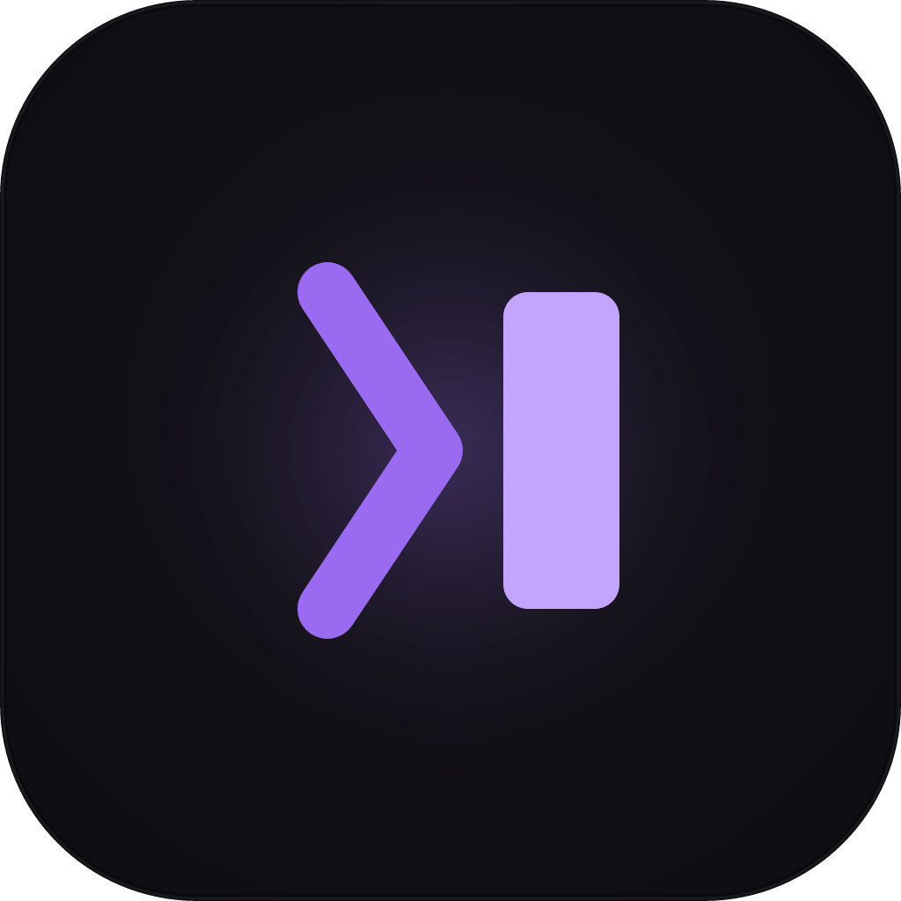

# myterm



A native Windows terminal emulator with its own window and tabs — built with
[egui](https://github.com/emilk/egui)/[eframe](https://github.com/emilk/egui)
for rendering and [egui_term](https://github.com/Harzu/egui_term) (backed by
[alacritty_terminal](https://github.com/alacritty/alacritty)) for PTY
management and VT/ANSI parsing.

## Features

Ideas borrowed from other terminals, credited where they came from:

| Feature | Inspired by |
| --- | --- |
| **Tabs**, each an independent shell with its own PTY | Konsole, Windows Terminal |
| **Split panes** with draggable dividers; unfocused panes are dimmed | Windows Terminal, iTerm2, Terminator |
| **Command palette** — fuzzy-search every action | Windows Terminal, VS Code, Warp |
| **Shell profiles** — new-tab dropdown with auto-detected shells (PowerShell, PowerShell 7, Command Prompt, WSL, Git Bash) | Windows Terminal |
| **Color schemes** — myterm, Dracula, Catppuccin Mocha, Tokyo Night, One Dark, Gruvbox Dark, Nord, Solarized Dark/Light | iTerm2, Alacritty, Windows Terminal |
| **Find in scrollback** (smart-case) | Windows Terminal, iTerm2 |
| **Font zoom** with keyboard or Ctrl + mouse wheel | every modern terminal |
| **Right-click copy / paste** — copies the selection, or pastes if nothing is selected | Windows Terminal, conhost, PuTTY |
| **Multi-line paste warning** and bracketed paste | Windows Terminal, Alacritty |
| Optional **copy on select** | xterm, PuTTY |
| **Rename tabs** (double-click), middle-click to close, right-click tab menu | Konsole, browsers |
| **Activity / bell indicators** on background tabs, and a taskbar flash on bell | Konsole, iTerm2 |
| **OSC 52** clipboard — programs like tmux/vim can set the clipboard | Alacritty, kitty |
| **Full screen** | Windows Terminal |
| Settings (scheme, font size, toggles) and window size **persist** between runs | — |

### Keyboard shortcuts

| Action | Shortcut |
| --- | --- |
| Command palette | `Ctrl+Shift+P` |
| New tab (default profile) | `Ctrl+Shift+T` |
| New tab with profile *N* | `Ctrl+Shift+1` … `Ctrl+Shift+9` |
| Split pane right / down | `Ctrl+Shift+E` / `Ctrl+Shift+O` |
| Close pane (closes the tab with its last pane) | `Ctrl+Shift+W` |
| Move focus between panes | `Alt+Arrow` |
| Next / previous tab | `Ctrl+Tab` / `Ctrl+Shift+Tab` |
| Go to tab *N* | `Ctrl+Alt+1` … `Ctrl+Alt+9` |
| Find | `Ctrl+Shift+F` (`Enter` = older match, `Shift+Enter` = newer, `Esc` closes) |
| Copy / paste | `Ctrl+Shift+C` / `Ctrl+Shift+V`, or right-click |
| Font size bigger / smaller / reset | `Ctrl+=` / `Ctrl+-` / `Ctrl+0`, or `Ctrl` + mouse wheel |
| Full screen | `F11` or `Alt+Enter` |

Mouse: click a tab to switch, double-click it to rename, middle-click or `x`
to close, right-click for a menu. `+` opens a new tab; the `⏷` next to it
lists profiles and appearance settings. Drag the line between panes to
resize them.

## Build

```
cargo build --release
```

The binary is written to `target/release/myterm.exe`.

### Toolchain

This project builds with the **GNU** Rust toolchain (`x86_64-pc-windows-gnu`)
plus a MinGW-w64 (WinLibs) linker, not MSVC — no Visual Studio Build Tools
required. If you're building on a fresh machine:

```
winget install --id Rustlang.Rustup -e
winget install --id BrechtSanders.WinLibs.POSIX.UCRT -e
rustup toolchain install stable-x86_64-pc-windows-gnu
rustup default stable-x86_64-pc-windows-gnu
```

Make sure the MinGW `bin` directory (containing `gcc.exe`) is on `PATH` —
and make sure that path has **no spaces** in it. MinGW's internal linker
invocation breaks on paths like `C:\Users\your name\...`; if your WinGet
install location has a space in it, copy the `mingw64` folder somewhere
space-free (e.g. `C:\mingw64`) and put that on `PATH` instead.

## Run

```
cargo run --release
```

or run the built exe directly:

```
target\release\myterm.exe
```

By default each new tab launches Windows PowerShell; the `⏷` dropdown (and
the command palette) list every other shell myterm found. To change the
default, set `MYTERM_SHELL`:

```
$env:MYTERM_SHELL = "pwsh.exe"
target\release\myterm.exe
```

## How it works

- `egui_term::TerminalBackend` opens a ConPTY per tab and spawns the shell
  attached to it, using `alacritty_terminal` for PTY I/O and VT/ANSI parsing.
- Each backend reports events (new output, title changes, exit) over an
  `mpsc` channel tagged with a tab id; `MyTermApp::update` drains that queue
  every frame and routes each event to the right tab.
- `egui_term::TerminalView` renders the parsed terminal grid directly with
  egui shapes and forwards keyboard/mouse input back into the PTY.
- Each tab holds a binary tree of panes (`src/panes.rs`); every pane has its
  own backend. App shortcuts are pulled out of egui's input queue before the
  terminal widget runs, so they never leak into the shell as control codes.
- When a shell exits its pane closes, then the tab with its last pane, then
  the window with its last tab.
- egui_term is vendored under `vendor/egui_term` with a few fixes (typing no
  longer stops when the mouse leaves the terminal, `Ctrl+U` works, multi-line
  copies keep their line breaks) and the scrollback search hook — see
  `vendor/egui_term/MYTERM_PATCHES.md`.

## Extending it

This is the base you own — natural next steps:
- Custom keybindings via `egui_term::Binding`/`BindingAction`
- Split panes (multiple `TerminalBackend`s laid out side by side in one tab)
- Persisted themes/fonts via `egui_term::TerminalTheme`/`TerminalFont`
- Session logging (hook into the PTY event stream)
